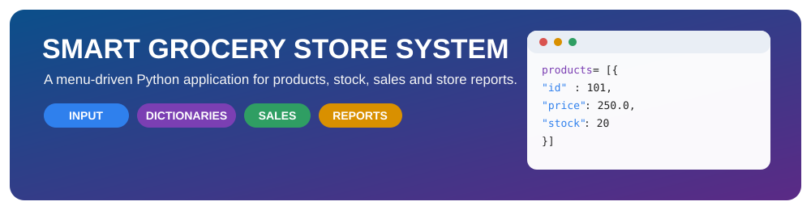
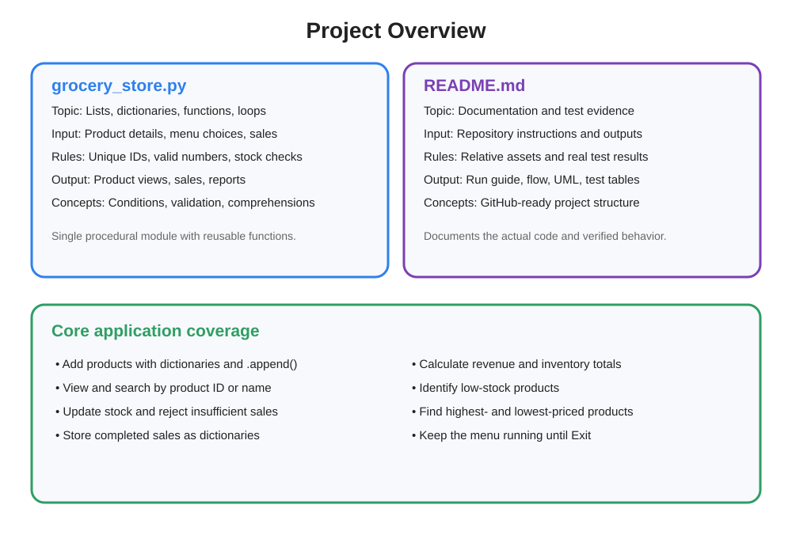

<p align="center"></p>

# Smart Grocery Store Management System

## 1. Project Overview

| Task | File | Topic |
|---|---|---|
| Product, stock, sales and reporting system | `grocery_store.py` | Lists, dictionaries, functions, loops, conditions, validation |

<p align="center"></p>

The application is a menu-driven grocery store system. It keeps products in a list of dictionaries and completed sales in a separate list of dictionaries. It supports product creation, viewing, searching, stock updates, customer sales, sales records, and a final store report.

## 2. Folder Structure

```text
smart-grocery-store-management-system/
├── grocery_store.py
├── README.md
└── assets/
    ├── banner.svg
    ├── banner.png
    ├── overview.svg
    ├── overview.png
    ├── add_product_flow.svg
    ├── add_product_flow.png
    ├── search_product_flow.svg
    ├── search_product_flow.png
    ├── update_stock_flow.svg
    ├── update_stock_flow.png
    ├── sale_flow.svg
    ├── sale_flow.png
    ├── report_flow.svg
    ├── report_flow.png
    ├── uml_diagram.svg
    └── uml_diagram.png
```

**Extra folder:** `assets/` is required by this submission specification for the SVG diagrams. The PNG copies are included so every SVG has a rendered visual check.

## 3. Product Management and Application Operations

### Summary

`grocery_store.py` uses a list of dictionaries for product data and a separate list of dictionaries for completed sales. The program runs through the required eight-option menu until the user selects Exit.

### Rules or Requirements

- Store multiple products in a list of dictionaries.
- Each product contains `id`, `name`, `category`, `price`, and `stock`.
- Add products with `.append()` and prevent duplicate IDs.
- Display all product details in a readable format.
- Search by product name or ID.
- Update stock by adding quantity or setting a new quantity.
- Process sales only when the product exists and enough stock is available.
- Deduct sold quantity and record completed sales.
- Generate product, inventory, transaction, revenue, low-stock, highest-price, and lowest-price results.
- Validate numeric input and menu choices.

### Program Flow

<p align="center"></p>

<p align="center"></p>

<p align="center"></p>

<p align="center"></p>

<p align="center"></p>

### Code Methods Description

| Method / Section | Purpose |
|---|---|
| `products` | Stores product dictionaries. |
| `sales_records` | Stores completed sale dictionaries. |
| `find_product_by_id()` | Searches the product list by ID. |
| `display_product()` | Prints one product in a readable format. |
| `get_positive_int()` | Validates positive integer input. |
| `get_non_negative_int()` | Validates zero or positive stock input. |
| `get_non_negative_float()` | Validates non-negative price input. |
| `add_new_product()` | Collects product data, checks duplicate IDs, creates a dictionary and uses `.append()`. |
| `display_all_products()` | Loops through and displays every product. |
| `search_product()` | Searches by exact product name or ID. |
| `update_product_stock()` | Adds stock or sets the available quantity. |
| `process_customer_sale()` | Validates the product and stock, calculates the total, deducts stock and records the sale. |
| `view_sales_records()` | Loops through completed sales and displays them. |
| `generate_store_report()` | Calculates inventory, sales, revenue, low-stock, highest-price and lowest-price results. |
| `show_menu()` | Displays the required application menu. |
| `main()` | Runs the menu loop and routes each choice to the correct function. |

### Input Validation

- Menu choices must be from `1` to `8`.
- Product IDs and purchase quantities must be positive whole numbers.
- New stock quantity may be zero or greater.
- Prices must be zero or greater and numeric.
- Product names and categories cannot be empty.
- Duplicate product IDs are rejected.
- Unknown product IDs are rejected.
- Sales above available stock are rejected.
- Invalid numeric input is caught with `ValueError` and the user is asked again.

### Expected Results

- New products are stored as dictionaries inside `products`.
- Existing products can be viewed or searched.
- Stock changes are reflected immediately in the product list.
- Successful sales reduce stock and create a sales record.
- Failed sales do not change stock or create a sales record.
- The report reflects the current in-memory product and sales data.

## 4. UML Diagram

A **module diagram** was chosen because this project is procedural rather than class-based; it shows the main module, data structures, function groups, and validation helpers.

<p align="center"></p>

## 5. Concepts and Techniques Used

- Python lists
- Python dictionaries
- Dictionary keys and values
- `.append()`
- `for` loops
- `while` loops
- `if / elif / else`
- Custom functions with `def`
- Input validation
- `try / except ValueError`
- List comprehension
- `sum()`, `max()`, and `min()` with key functions
- Constants instead of repeated magic values
- Menu-driven program design
- In-memory sales records

## 6. How to Run

### Requirements

- Python 3.x
- No external Python packages are required to run the application.

### Clone the repository

Replace `your-username` with the actual GitHub username before running the command:

```bash
git clone https://github.com/your-username/smart-grocery-store-management-system.git
cd smart-grocery-store-management-system
```

### Run the program

```bash
python grocery_store.py
```

Alternative commands:

```bash
python3 grocery_store.py
```

Windows Python launcher:

```bash
py grocery_store.py
```

## 7. Sample Execution

The following examples are taken from real runs of the submitted program.

### Successful sale

```text
--- Process Customer Sale ---
Enter product ID: 104
Enter purchase quantity: 5
Sale completed successfully.
Product: Apple
Quantity sold: 5
Total amount: Rs. 600.00
Remaining stock: 0
```

### Failed sale — insufficient stock

```text
--- Process Customer Sale ---
Enter product ID: 101
Enter purchase quantity: 99
Sale rejected: Only 20 unit(s) of Milk are available.
```

### Failed search — product does not exist

```text
--- Search Product ---
Enter product name or ID: 999
Product not found.
```

### Duplicate product ID

```text
--- Add New Product ---
Enter product ID: 101
Error: Product ID already exists. Choose a unique ID.
```

### Store report after the tested successful sale

```text
--- Store Report ---
Total number of products: 4
Total available stock: 40
Total sales transactions: 1
Total revenue generated: Rs. 600.00
Products with stock below 5 units:
- Apple (0 units)
Product with highest price: Rice (Rs. 320.00)
Product with lowest price: Apple (Rs. 120.00)
```

## 8. Test Cases

| # | Scenario | Inputs | Expected result |
|---|---|---|---|
| 1 | View products | `2` | Displays the three initial products. |
| 2 | Search missing product | `3`, `999` | Displays `Product not found.` |
| 3 | Duplicate ID | `1`, `101` | Rejects the duplicate ID. |
| 4 | Add product | `1`, `104`, `Apple`, `Fruits`, `120`, `3` | Adds Apple as a new dictionary. |
| 5 | Update stock | `4`, `104`, `2`, `5` | Sets Apple stock to 5. |
| 6 | Successful sale | `5`, `104`, `5` | Records a Rs. 600.00 sale and leaves 0 stock. |
| 7 | Oversized sale | `5`, `101`, `99` | Rejects the sale because Milk has only 20 units. |
| 8 | Unknown product sale | `5`, `999` | Rejects the sale because the product does not exist. |
| 9 | Invalid menu option | `9` | Displays the menu validation error. |
| 10 | Sales records | `6` after a successful sale | Displays the completed sale. |
| 11 | Store report | `7` after the tested sale | Calculates product count, stock, transactions, revenue and price/stock findings. |
| 12 | Exit | `8` | Ends the program with a confirmation message. |

### Verification

- Python syntax compilation: **passed** with `python -m py_compile grocery_store.py`.
- Real interactive execution: **passed** for normal, duplicate-ID, missing-product, invalid-menu, successful-sale, insufficient-stock, sales-record, and report cases.
- SVG rendering: **passed** for all seven SVG diagrams and the banner/overview assets; PNG renders were visually inspected for clipping and overlap.

## Author

**Author:** Your Name  
**GitHub:** https://github.com/your-username
